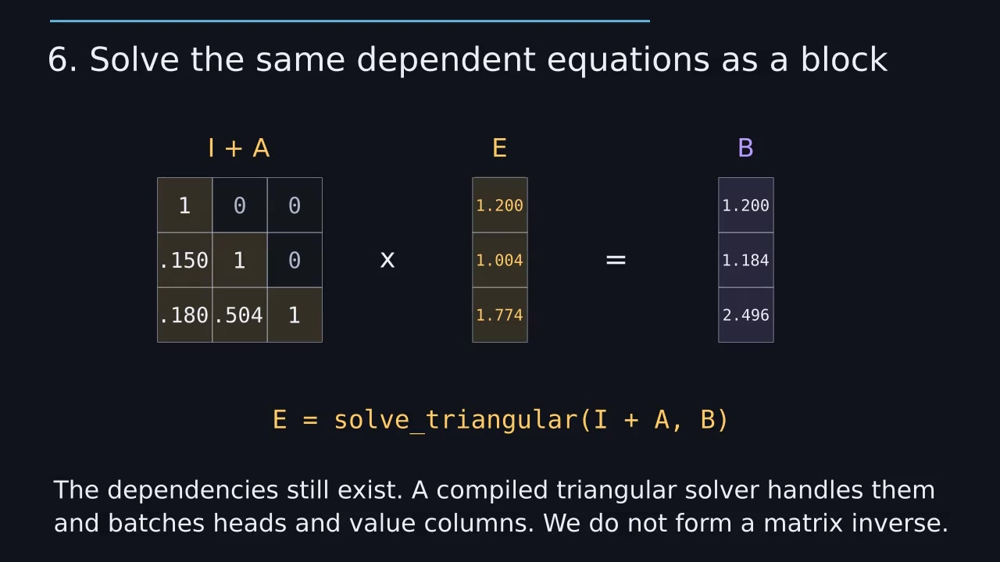

# Linear attention and Kimi Delta Attention practice

This track builds recurrent linear attention from first principles and
progresses toward an educational implementation of Kimi Delta Attention (KDA).
Exercise prompts and interview questions live here; completed reasoning and
corrections are recorded in `SOLUTIONS.md`.

Status: **complete for the educational scope**. The learner implemented the
recurrent operators and full KDA layer; Codex supplied the chunkwise worked
example at the learner's request. Production WY kernels remain optional.

The default implementation is intentionally recurrent and written in ordinary
PyTorch. An AI-authored chunkwise worked example is also available for study;
optimized WY kernels remain optional, not prerequisites for understanding KDA.

Primary references:

- [Kimi Linear technical report](https://arxiv.org/abs/2510.26692)
- [Official recurrent KDA reference](https://github.com/fla-org/flash-linear-attention/blob/main/fla/ops/kda/naive.py)
- [Official KDA layer](https://github.com/fla-org/flash-linear-attention/blob/main/fla/layers/kda.py)

## Conventions

This repository uses head-first tensors:

```text
q, k:          [B, H, S, Dk]
v, output:     [B, H, S, Dv]
state:         [B, H, Dk, Dv]
beta:          [B, H, S]
scalar alpha:  [B, H, S]
KDA alpha:     [B, H, S, Dk]
```

The official FLA operators generally use sequence-first `[B, S, H, D]`
tensors. Do not copy shapes from the reference implementation without adapting
them.

## Exercise 1: Plain recurrent linear attention (completed)

Implement `naive_recurrent_linear_attention` in `linear_attention.py`.

For each sequence position:

1. Write the key/value association into a matrix state.
2. Read the updated state with the current query.
3. Retain only one recurrent state rather than every prefix state.

The function supports an optional initial state and optionally returns its
final state so separate calls can continue the same sequence.

### Discussion questions

1. Why is the state shaped `[Dk, Dv]`?
2. What does `k_t @ state` represent?
3. Why does writing an association require an outer product rather than a dot
   product?
4. Why must every query read a different prefix state in a causal model?
5. Why does `K.transpose(-1, -2) @ V` alone provide only the final state?
6. How is the recurrence equivalent to a causal `[S, S]` parallel form?
7. Why does materializing every prefix state lose the memory advantage?
8. What is the purpose of `initial_state` and `output_final_state`?

## Exercise 2: DeltaNet recurrent correction (completed)

Create `delta_net.py` and implement:

```python
def naive_recurrent_delta_net(
    q: torch.Tensor,
    k: torch.Tensor,
    v: torch.Tensor,
    beta: torch.Tensor,
    initial_state: torch.Tensor | None = None,
    *,
    output_final_state: bool = False,
) -> tuple[torch.Tensor, torch.Tensor | None]: ...
```

Required behavior:

- Use the same Q/K/V and state shapes as Exercise 1.
- Accept one scalar write-strength gate per batch row, head, and token.
- Read the state's current prediction for a key before writing.
- Write only the prediction error rather than blindly adding the complete
  value.
- Read the updated state with the current query.
- Support initial/final state continuation.
- Assume keys are L2-normalized; normalization belongs to the later layer
  wrapper.

### Discussion questions

1. Why does additive linear attention fail to overwrite an existing
   association cleanly?
2. What prediction is compared with the desired value?
3. Why is the correction written along the current key direction?
4. What does `beta=0` mean? What does `beta=1` mean?
5. With an L2-normalized key and `beta=1`, why does the updated memory predict
   exactly the new value for that key?
6. Which parts of the state remain unchanged by one rank-one correction?

## Exercise 3: Gated DeltaNet (completed)

Extend DeltaNet with a learned scalar decay `alpha_t` per head and token.
Decay the previous state before calculating the delta-rule prediction and
correction.

### Discussion questions

1. Why does the delta rule still need a forgetting mechanism?
2. What are the effects of decay values one and near zero?
3. Why must the correction use the already-decayed state?
4. What limitation remains when one scalar controls the complete head state?

## Exercise 4: Recurrent Kimi Delta Attention core (completed)

Create `kimi_delta_attention.py`. Replace Gated DeltaNet's scalar decay with a
channel-wise decay shaped `[B, H, S, Dk]`. Each key channel independently
decays its complete row of value information.

Implement the recurrent operator before implementing projections or
convolutions. Keep the initial version to equal query/key/value head counts;
grouped value attention can be added later.

### Discussion questions

1. How does a `[Dk]` decay vector broadcast over a `[Dk, Dv]` state?
2. What additional expressiveness does channel-wise decay provide over one
   scalar per head?
3. In what order are decay, prediction, correction, and query readout applied?
4. Why is the persistent decoding state independent of sequence length?
5. How does its memory cost compare with a growing KV cache?

## Exercise 5: Educational KDA layer (completed)

Wrap the verified recurrent operator in an `nn.Module` that follows the Kimi
Linear layer design while remaining readable.

Required components:

- Q, K, and V projections (a fused projection followed by a split is fine when
  their projected widths are equal).
- Separate causal depthwise short convolutions for projected Q, K, and V.
- SiLU activation after each short convolution.
- L2 normalization of Q and K.
- A sigmoid scalar `beta` projection per head.
- A channel-wise decay gate. Follow the paper-aligned log-space
  parameterization after first validating the recurrence with direct decay
  inputs.
- Per-head RMS normalization of the recurrent output.
- A data-dependent sigmoid output gate and final output projection.
- Recurrent matrix-state caching for decoding.
- Q/K/V convolution-tail caching for decoding.

The short convolution must be causal. On a first call, a zero-filled tail of
length `kernel_size - 1` provides left padding. Later calls reuse the saved
projected Q/K/V inputs from the previous call. The layer cache carries those
three fixed-size tails and the recurrent matrix state.

### Discussion questions

1. Why are the short convolutions depthwise rather than channel-mixing?
2. Why do Q, K, and V need separate convolution parameters and caches?
3. Why are Q and K normalized but V is not?
4. Why represent decay in log space before exponentiating it?
5. What state must be carried between decode calls?
6. Why does KDA not use RoPE in the Kimi Linear architecture?
7. Why does Kimi Linear retain periodic full-attention layers rather than
   using only KDA?

## Exercise 6: Chunkwise parallel KDA (completed worked example; AI-authored)

Study how the recurrence becomes a chunkwise triangular system, compare the
worked implementation with the recurrent reference, and understand why this
educational form is not the paper's optimized WY kernel.

### Worked implementation (AI-authored)

[chunked_kda.py](chunked_kda.py) was **written by Codex at my request**, not
implemented by me as an exercise. The assistant also wrote its tests and the
optional selection branch in the layer. My recurrent implementation remains
the default and the reference for checking this worked example.

```python
from linear_attention import KimiDeltaAttention

recurrent = KimiDeltaAttention(d_model=128, num_heads=4, kernel_size=4)
chunked = KimiDeltaAttention(
    d_model=128, num_heads=4, kernel_size=4, chunk_size=32
)
chunked.load_state_dict(recurrent.state_dict())
```

Both paths share projections, convolutions, gates, output processing, and the
same `KDACache`. Only the state operator changes. The standalone chunked
operator accepts `log_retention`, whereas `recurrent_kda` accepts retention
itself. The layer already computes log-retention, so no conversion back from
potentially underflowed zeros is needed.

Read the four numbered sections alongside the [code walkthrough](SOLUTIONS.md#chunkwise-code-walkthrough-ai-authored):
build surviving keys, solve the errors, read the outputs, then carry the final
state to the next chunk. There is a loop over chunks, not over tokens.

Arithmetic and cached state use float32 (float64 for float64 inputs), including
under AMP; output keeps the value tensor's dtype. This example explicitly
allocates `[B, H, C, C, Dk]` pairwise tensors. It illustrates the math, not a
guaranteed speedup or production memory optimization.

```bash
uv run pytest linear_attention/test_chunked_kda.py -q
```

Tests compare outputs, states, input and layer-parameter gradients, cache
continuation, causality, gate extremes, and low-precision behavior.

### Visual lesson

[](visuals/kda_chunking.mp4)

[Watch the narrated, captioned Manim video](visuals/kda_chunking.mp4), then use the
[illustrated lesson notes and rendering instructions](visuals/README.md) to
revisit individual steps. It follows the same three-token example through
decay, key alignment, a triangular error system, outputs, and outgoing memory.
The animation teaches the same exact regrouping used by the worked operator;
the paper's optimized WY kernels require additional work.

## Completed track

Completed:

- Plain recurrent linear attention, DeltaNet, scalar-gated DeltaNet, and the
  channel-wise recurrent KDA core.
- Causal depthwise short convolution and its shape, causality, and
  channel-independence tests.
- An educational `KimiDeltaAttention` layer with fused QKV projection,
  separate Q/K/V convolutions, SiLU, Q/K L2 normalization, log-space
  channel-wise retention, a sigmoid beta gate, head-wise output RMSNorm,
  learned sigmoid output gate, and final output projection.
- A `KDACache` carries the recurrent state and separate projected Q/K/V tails.
  Full-sequence and split-sequence calls match for convolution kernel sizes
  1, 3, and 4.
- The decay input bias is initialized from log-uniform positive steps in
  `[0.001, 0.1]` via inverse-softplus. `reset_parameters()` initializes only
  this layer's direct decay parameters and supports reinitialization after
  meta-device materialization.
- The decay input projection now uses a `d_model -> head_dim -> d_model`
  bottleneck with no biases or intermediate activation. The output gate uses
  the same bottleneck, with a bias only in its final projection so each output
  feature can learn a default gate value.
- Each head's positive decay rate is sampled uniformly from `[1, 16]`, then
  stored as its logarithm. The focused KDA test file has 22 passing tests.
- An explicitly AI-authored educational chunkwise operator and optional layer
  switch, with equivalence and gradient tests against the learner's recurrence.

The educational linear-attention/KDA track is done. The four numbered code
sections and animation remain review material, not a pending implementation
exercise. The learner asked the assistant to supply chunking as teaching
material; do not count it as learner-written code. Production WY kernels
remain optional. See the root roadmap for subsequent topics.
